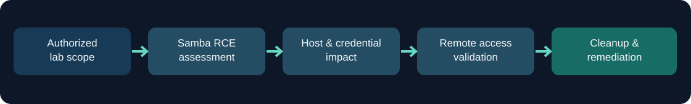
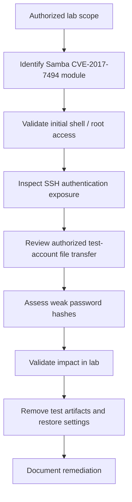

# Samba Security Assessment: CVE-2017-7494

  

An **authorized, isolated-lab security assessment** documenting a vulnerable Samba service, the impact of initial remote code execution, credential exposure, persistence risks, and cleanup. The project includes an original **read-only SSH configuration auditor** as a defensive companion utility.

> This repository is a case study of a completed class exercise, not a deployable exploitation framework. It does not include exploit payloads, captured credentials, password hashes, reverse shells, or live target addresses.

## At a glance

| Item | Details |
|---|---|
| Assessment focus | Samba vulnerability **CVE-2017-7494**, post-exploitation exposure, credential hygiene |
| Environment | Kali Linux and a deliberately vulnerable Linux/Samba lab target |
| Tools used in the documented exercise | Metasploit Framework, SSH, Netcat, John the Ripper |
| Outcome documented | A command shell and root privileges; authorized SSH access testing; test-account password recovery; cleanup |
| Added portfolio utility | Python **read-only SSH configuration checker** with unit tests |

## Assessment workflow





## Findings and evidence

| Finding | Evidence from lab write-up | Security impact | Recommended control |
|---|---|---|---|
| Vulnerable Samba service | A Metasploit module associated with **CVE-2017-7494** was selected and used against the authorized target | Remote code execution on a vulnerable, reachable server | Upgrade to a patched Samba release; limit SMB reachability |
| Privilege exposure | The resulting session was verified with `whoami` as root | Compromise of privileged operations and local data | Reduce service privileges and isolate vulnerable services |
| SSH configuration risk | Password authentication was temporarily enabled during testing | Broader password-based access surface | Restore hardened SSH settings and prefer key authentication |
| Account-file exposure | Lab copies of `passwd` and `shadow` were transferred to Kali for testing | Offline password-guessing risk if privileged files are exposed | Restrict privileged file access, use strong unique passwords and strong hashing |
| Weak test passwords | John the Ripper recovered test-account credentials | Weak credentials can magnify a host compromise | Strengthen password policy and rotate affected credentials |
| Remote access validation | A controlled reverse-shell connection was demonstrated | Evidence of ability to operate remotely from compromised host | Outbound network restrictions and alerting |
| Post-test cleanup | Temporary account, SSH configuration changes, and test artifact were removed | Helps restore the deliberately modified lab environment | Verify changes are reverted and conduct post-test review |

**Evidence attribution:** Findings and outcomes above come from the supplied 16-page *CYSE 425 - Lab 1* report. See [docs/assessment.md](docs/assessment.md) for a page-indexed narrative. No attempt was made to independently reproduce the attack in this repository.

## Defensive companion: SSH configuration audit

A local, **read-only** script highlights SSH directives that can increase risk. It does **not** edit configuration, start a service, connect to hosts, or exploit vulnerabilities. Its checks are intentionally narrow: they are best-effort static checks, **not** an equivalent of `sshd -T` or an OS hardening audit.

```bash
python3 scripts/ssh_config_audit.py examples/sshd_config.sample
python3 -m unittest discover -s tests -v
```

Example output:

```text
SSH configuration review: examples/sshd_config.sample
[WARN] PasswordAuthentication yes (line 3)
[WARN] PermitRootLogin yes (line 4)
[INFO] Static file check only; Match/Include contexts not fully evaluated.
```

The example intentionally has insecure settings. The auditor exits with code 1 when it finds warnings.

### Project structure

```text
.
├── README.md
├── docs/
│   ├── assessment.md          # Lab stages, results, and references to report pages
│   ├── remediation.md         # Practical defensive lessons
│   └── responsible-use.md     # Public artifact and authorization boundaries
├── examples/
│   └── sshd_config.sample     # Synthetic example; not taken from the target
├── scripts/
│   └── ssh_config_audit.py    # Original read-only companion script
├── tests/
│   └── test_ssh_config_audit.py
├── assets/
│   └── assessment-flow.svg    # Diagram of the documented workflow
└── .gitignore
```

## What this project demonstrates

- Understanding of the exploitation-to-impact lifecycle in a controlled environment.
- Practical familiarity with Linux privilege context, SSH authentication configuration, and file permissions.
- Awareness of the relationship between host compromise and credential compromise.
- Ability to document evidence, propose remediations, and remove test artifacts.
- Small-scale defensive Python scripting and automated testing.

## Important limitations

- The original report is a **lab narrative**, not a full commercial penetration test. It does not establish patch-version evidence, exhaustive network scope, formal CVSS scoring, or remediation verification.
- The extracted findings are limited to what the report actually documents.
- The audit script is an **additional portfolio tool created from this case study**. It is not represented as code run in the original lab.
- Screenshots, account files, packet captures and raw report PDFs have intentionally **not** been published pending a manual privacy and security review.

## Source & attribution

Course: **CYSE 425** — Lab 1. Report author: Harshith Motipalli. The supporting analysis is an adapted summary of the supplied lab report.

## Responsible use

Perform security testing only on systems you own or have explicit permission to test. See [docs/responsible-use.md](docs/responsible-use.md).
